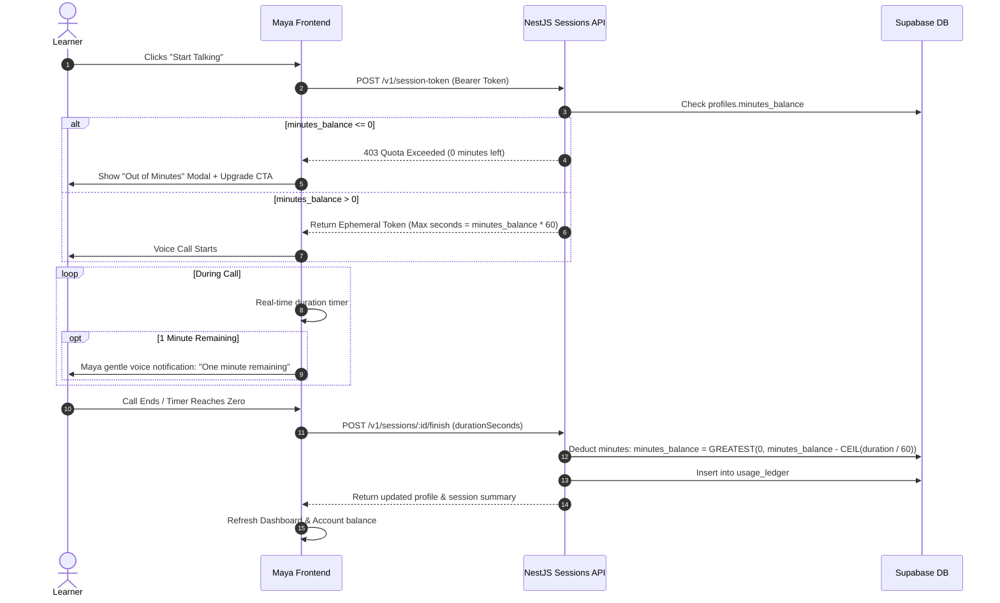

# Implementation Plan: Enterprise Onboarding Flow, SMS OTP Gateway, Starter Plan & Minutes Allocation

**Status:** Proposed / Awaiting Review  
**Author:** Antigravity  
**Date:** 2026-10-14  
**Target Platform:** Expo / React Native (Web + Mobile), NestJS Backend, Supabase Database  

---

## 1. Executive Summary & Goals

This plan outlines the architecture and execution steps to transition Maya AI from a prototype URL-query-based onboarding flow into an **enterprise-grade, secure, multi-step onboarding and authentication system**:

1. **Enterprise State Management:** Replace vulnerable and messy URL query parameter chaining (`?name=...&phone=...&goal=...`) across all 21 onboarding screens with a centralized, typed, persistent **Onboarding Store** (`useOnboardingStore`).
2. **SMS Gateway & Secure OTP Verification:**
   - Real phone verification with rate limiting, cooldown timers (60s), tamper-proof expiration (5 mins), and max retry protection (3 attempts).
   - Pluggable SMS Gateway architecture (Mock / Dev provider + Production Sri Lanka SMS Gateway integration).
3. **Automated Account Creation & 10-Minute Monthly Starter Plan:**
   - On OTP verification, create user account and activate **Starter Plan**.
   - Allocate **10 Free Practice Minutes per month** (`monthly_minutes_allowance = 10`, `minutes_balance = 10`) with a monthly renewal cycle (`minutes_reset_at`).
   - Automated monthly quota refresh: If `NOW() >= minutes_reset_at`, the starter balance resets to 10 minutes for the new monthly cycle.
   - Persist user learning preferences (native language, proficiency level, primary goal, daily commitment, challenge).
4. **Dynamic Dashboard & Account UI:**
   - Display real authenticated user data, Starter Plan badge, live remaining minutes meter (`10 min remaining this month · Renews monthly`), and profile preferences.
5. **Session/Call Consumption Architecture:**
   - Build quota-gated session token creation and post-call deduction logic ready for voice calls.

---

## 2. Architecture Comparison: Current vs. Enterprise

```mermaid
flowchart TD
    subgraph Current ["Current Architecture (Fragile & Leaky)"]
        S1["Screen 1 (Name)"] -->|"?name=Tharindu"| S2["Screen 2 (Phone)"]
        S2 -->|"?name=...&phone=..."| S3["Screen 3 (OTP)"]
        S3 -->|"?name=...&phone=...&verified=true"| S4["Screen 4 (Goal)"]
        S4 -->|18 more screens chaining query params...| SD["Dashboard (Hardcoded Fallbacks)"]
    end

    subgraph Enterprise ["Enterprise Architecture (Secure & Resilient)"]
        Store[("Central Typed Onboarding Store\n(Zustand + Secure Storage)")]
        Screen["Any Onboarding Screen"] <-->|Read / Write State| Store
        Router["Expo Router (Clean URLs)"] --- Screen
        
        ScreenOTP["OTP Screen"] -->|POST /v1/auth/otp/verify| Backend["NestJS AuthModule"]
        Backend -->|Verify & Lockout Check| DB[(Supabase DB)]
        Backend -->|Create User + Starter Plan + 10 Mins/Month| DB
        Backend -->|Return Auth Token + User Profile| ScreenOTP
        ScreenOTP -->|Save Auth Session| AuthStore[("Auth & User Session Store")]
        
        FinalScreen["Onboarding Finish"] -->|PATCH /v1/profiles/me\n(Preferences Payload)| Backend
        Backend -->|Persist Preferences| DB
        Dashboard["Dashboard & Account Screens"] <-->|Live User & Quota State| AuthStore
    end
```

---

## 3. Plans Catalog & Quotas Architecture

Maya AI supports four subscription tiers plus on-demand minute top-up packs. The system is designed to work seamlessly with all plans now, with payment gateway integration (PayHere / Stripe / Genie) plugged in seamlessly:

### 3.1. Subscription Plan Matrix

| Plan Tier | Price (LKR) | Monthly AI Minutes | Features & Privileges | Target Audience |
| :--- | :--- | :--- | :--- | :--- |
| **Starter (Free)** | **LKR 0** | **10 min / mo** | Basic AI speaking partner, 10 minutes monthly refresh | New signups & free trial |
| **Basic** | **LKR 2,700 / mo** | **450 min / mo** | AI partner, grammar corrections, session transcript, voice captions | Casual & beginning learners |
| **Pro** *(Most Popular)* | **LKR 3,600 / mo** *(or LKR 8,640 / 3 mo)* | **600 min / mo** | Everything in Basic + advanced pronunciation feedback, rephrasing suggestions, full history, roadmap tracking | Consistent daily learners |
| **Premium** | **LKR 7,200 / mo** | **1,200 min / mo** | Everything in Pro + detailed speaking analytics, personalized learning insights, priority AI latency, early feature access | Serious & intensive learners |

### 3.2. On-Demand "Get Extra Time" Add-On Packs (Non-Expiring Top-Ups)
- **+30 Min Quick Boost:** Rs. 300
- **+120 Min Keep Going:** Rs. 900 *(Most Popular)*
- **+300 Min Max Practice:** Rs. 2,000

---

## 4. Database Schema Updates (`maya-backend/src/database/`)

### Migration: `004_auth_otp_and_plans_catalog.sql`

```sql
-- 1. Phone OTP Verification & Rate-Limiting Table
CREATE TABLE IF NOT EXISTS public.phone_verifications (
  id UUID PRIMARY KEY DEFAULT gen_random_uuid(),
  phone_number TEXT NOT NULL,
  otp_hash TEXT NOT NULL,
  attempts INTEGER DEFAULT 0,
  max_attempts INTEGER DEFAULT 3,
  is_verified BOOLEAN DEFAULT false,
  expires_at TIMESTAMPTZ NOT NULL,
  verified_at TIMESTAMPTZ,
  created_at TIMESTAMPTZ DEFAULT NOW(),
  updated_at TIMESTAMPTZ DEFAULT NOW()
);

CREATE INDEX IF NOT EXISTS idx_phone_verifications_phone 
  ON public.phone_verifications(phone_number, created_at DESC);

-- 2. Enhance Profiles Table with Multi-Tier Plans & Quotas
ALTER TABLE public.profiles
  ADD COLUMN IF NOT EXISTS plan_tier TEXT CHECK (plan_tier IN ('starter', 'basic', 'pro', 'premium')) DEFAULT 'starter',
  ADD COLUMN IF NOT EXISTS plan_status TEXT CHECK (plan_status IN ('active', 'trialing', 'past_due', 'canceled')) DEFAULT 'active',
  ADD COLUMN IF NOT EXISTS billing_cycle TEXT CHECK (billing_cycle IN ('monthly', 'quarterly', 'yearly')) DEFAULT 'monthly',
  ADD COLUMN IF NOT EXISTS monthly_minutes_allowance INTEGER DEFAULT 10,
  ADD COLUMN IF NOT EXISTS add_on_minutes_balance INTEGER DEFAULT 0,
  ADD COLUMN IF NOT EXISTS minutes_reset_at TIMESTAMPTZ DEFAULT (NOW() + INTERVAL '1 month'),
  ADD COLUMN IF NOT EXISTS native_language TEXT DEFAULT 'sinhala',
  ADD COLUMN IF NOT EXISTS employment_status TEXT,
  ADD COLUMN IF NOT EXISTS daily_goal_minutes INTEGER DEFAULT 10,
  ADD COLUMN IF NOT EXISTS baseline_fluency_score INTEGER DEFAULT 0,
  ADD COLUMN IF NOT EXISTS baseline_grammar_score INTEGER DEFAULT 0,
  ADD COLUMN IF NOT EXISTS baseline_pronunciation_score INTEGER DEFAULT 0,
  ADD COLUMN IF NOT EXISTS onboarding_completed_at TIMESTAMPTZ;

-- 3. Invoices / Order Transactions (Payment Gateway Ready)
CREATE TABLE IF NOT EXISTS public.orders (
  id UUID PRIMARY KEY DEFAULT gen_random_uuid(),
  user_id UUID NOT NULL REFERENCES public.profiles(id) ON DELETE CASCADE,
  order_type TEXT CHECK (order_type IN ('subscription_new', 'subscription_renewal', 'add_on_topup')) NOT NULL,
  plan_tier TEXT,
  add_on_package_id TEXT,
  amount_lkr NUMERIC(10, 2) NOT NULL,
  minutes_credited INTEGER NOT NULL,
  payment_gateway TEXT DEFAULT 'mock', -- e.g. 'payhere', 'stripe', 'mock'
  gateway_payment_id TEXT,
  status TEXT CHECK (status IN ('pending', 'completed', 'failed', 'refunded')) DEFAULT 'completed',
  created_at TIMESTAMPTZ DEFAULT NOW()
);

-- Ensure initial minutes balance defaults to 10 for starter
ALTER TABLE public.profiles 
  ALTER COLUMN minutes_balance SET DEFAULT 10;
```

---

## 5. Backend Implementation (`maya-backend`)

### 4.1. New `AuthModule` (`src/auth/`)
Organized according to Rule `04-backend-nestjs.md`:
- `auth.module.ts`: NestJS module registering controllers, services, and SMS providers.
- `auth.controller.ts`: REST endpoints with DTO validation.
- `auth.service.ts`: Business logic for OTP generation, hashing, rate limiting, and verification.
- `sms/`:
  - `sms-gateway.interface.ts`: `ISmsGatewayProvider { sendOtp(phone: string, code: string): Promise<boolean> }`
  - `mock-sms.provider.ts`: Logs OTP in development/test, supports pre-configured dev numbers (`+94771234567`).
  - `production-sms.provider.ts`: Sri Lanka SMS gateway driver (e.g. Textware / Notify.lk / Twilio).

### 4.2. API Endpoints Contract

#### Endpoint 1: Request OTP
- **`POST /v1/auth/otp/send`**
- **Request Body (DTO):**
  ```json
  {
    "phoneNumber": "+94771234567"
  }
  ```
- **Validation:**
  - Valid E.164 phone number.
  - Cooldown: Must be ≥ 60 seconds since last OTP sent to this number.
  - Rate ceiling: Max 5 OTP requests per hour per IP/number.
- **Response:**
  ```json
  {
    "success": true,
    "cooldownSeconds": 60,
    "expiresInSeconds": 300,
    "message": "Verification code sent successfully"
  }
  ```

#### Endpoint 2: Verify OTP & Provision Starter Account
- **`POST /v1/auth/otp/verify`**
- **Request Body (DTO):**
  ```json
  {
    "phoneNumber": "+94771234567",
    "code": "482915"
  }
  ```
- **Business Logic:**
  - Verifies code hash match and expiration (`expires_at > NOW()`).
  - Check attempts: if `attempts >= 3`, fail with `429 Too Many Attempts` and invalidate code.
  - On success:
    - Finds or creates user profile in Supabase.
    - If new user: sets `plan_tier = 'starter'`, `plan_status = 'active'`, `minutes_balance = 10`.
    - Generates user session access token (JWT).
- **Response:**
  ```json
  {
    "success": true,
    "accessToken": "eyJhbGciOi...",
    "isNewUser": true,
    "user": {
      "id": "uuid-...",
      "phoneNumber": "+94771234567",
      "displayName": null,
      "planTier": "starter",
      "planStatus": "active",
      "minutesBalance": 10
    }
  }
  ```

#### Endpoint 3: Save Onboarding Preferences
- **`POST /v1/users/onboarding-preferences`**
- **Headers:** `Authorization: Bearer <accessToken>`
- **Request Body (DTO):**
  ```json
  {
    "displayName": "Kavindu",
    "nativeLanguage": "sinhala",
    "level": "Intermediate",
    "goal": "workplace",
    "challenge": "vocabulary",
    "employmentStatus": "Software Engineer",
    "dailyGoalMinutes": 15,
    "baselineScores": {
      "overall": 82,
      "fluency": 80,
      "grammar": 84,
      "pronunciation": 82
    }
  }
  ```
- **Response:**
  ```json
  {
    "success": true,
    "profile": { ... }
  }
  ```

---

## 5. Frontend Implementation (`maya-frontend`)

### 5.1. Centralized Typed Onboarding Store (`src/services/store/onboarding-store.ts`)
Creates a reactive, typed store with cross-platform persistence:

```typescript
export interface OnboardingState {
  // Step 1: Personal info
  displayName: string;
  phoneNumber: string;
  isPhoneVerified: boolean;
  accessToken: string | null;

  // Step 2: Learning goals & preferences
  nativeLanguage: 'sinhala' | 'tamil';
  goal: string;
  challenge: string;
  level: string;
  employment: string;
  dailyGoalMinutes: number;

  // Step 3: Diagnostic / Baseline call
  hasCompletedIntroCall: boolean;
  baselineScores: {
    overall: number;
    fluency: number;
    grammar: number;
    pronunciation: number;
  } | null;

  // Actions
  setName: (name: string) => void;
  setPhone: (phone: string) => void;
  setVerifiedToken: (token: string, user: any) => void;
  setPreferences: (prefs: Partial<OnboardingState>) => void;
  clearOnboarding: () => void;
}
```

### 5.2. Refactoring the 21 Onboarding Screens
Each screen will:
1. **Drop `useLocalSearchParams` query chaining.**
2. Read state directly from `useOnboardingStore(state => state.field)`.
3. Save state with store setters (e.g., `setName(name)`).
4. Perform clean navigation: `router.push('/onboarding/phone')` without URL query parameters.
5. If the page is reloaded in browser, user data is safely preserved in local storage.

### 5.3. Phone & OTP Screen Real Integration
- **`phone.tsx`:**
  - Invokes `authService.sendOtp(cleanPhone)`.
  - Shows real error messages (invalid number, rate limit wait time).
  - Navigates cleanly to `/onboarding/otp`.
- **`otp.tsx`:**
  - Automatically handles 6-digit input and paste.
  - Active 60s countdown timer with Resend OTP button invoking `/v1/auth/otp/send`.
  - Invokes `authService.verifyOtp(phone, otpCode)`.
  - On approval:
    - Stores `accessToken` in SecureStore / LocalStorage.
    - Updates `user` session in `useUserStore`.
    - Navigates smoothly to `/onboarding/goal`.

---

## 6. Dashboard & Account Screens Dynamic Integration

### 6.1. Live User Profile Hook (`useUserProfile`)
- Subscribes to real user data from Supabase/Backend API.
- Fallback for guests / unauthenticated preview mode.

### 6.2. Dashboard Screen (`src/app/(tabs)/dashboard.tsx`)
- Greeting: `"Good morning, {profile.displayName || 'Learner'} 👋"`.
- Minutes Widget:
  - `"Starter Plan Active"` pill badge.
  - `"10 min practice time available"`.
  - Progress bar showing remaining time vs initial 10 mins.
  - Upgrade CTA button linking to `/upgrade`.
- Curated Scenarios aligned with user's selected `goal` and `level`.

### 6.3. Account Screen (`src/app/(tabs)/account.tsx`)
- Profile card displaying:
  - User's Name and Phone Number (`+94 77 ••• ••67`).
  - Level Badge (`Intermediate`, `Beginner`, etc.).
- Plan & Quotas card:
  - **Current Plan:** Starter Plan (Free)
  - **Status:** Active
  - **Remaining Time:** `10m 00s`
  - **Daily Goal:** `15 min / day`
  - **Native Language:** `Sinhala`
- Buttons: "Upgrade to Pro" & "Get Extra Minutes".

---

## 7. Minute Consumption for Calls & Sessions (Future Integration Readiness)



---

## 8. Detailed Execution Steps & Milestones

| Step | Component | Tasks | Verification |
| :--- | :--- | :--- | :--- |
| **Phase 1** | Database | Create migration for `phone_verifications` table & alter `profiles` with starter plan columns and 10 mins default. | Execute SQL in Supabase / Local DB. |
| **Phase 2** | Backend Auth | Implement `AuthModule`, `SmsGatewayService`, `POST /v1/auth/otp/send`, and `POST /v1/auth/otp/verify`. | Unit & e2e tests for OTP generation, expiry, and rate limiting. |
| **Phase 3** | Frontend Store | Build `useOnboardingStore` with persistent storage; create typed auth service. | Unit test store state persistence across reload. |
| **Phase 4** | Onboarding Screens | Refactor `phone.tsx` & `otp.tsx` to connect to real endpoints; clean URL navigation across all 21 screens. | Walk through full onboarding flow without any query params in URL. |
| **Phase 5** | Preferences API | Endpoint `POST /v1/users/onboarding-preferences` saving all user choices to DB. | Verify DB record updated with correct level, goal, and scores. |
| **Phase 6** | Dashboard & Account | Hook up `dashboard.tsx` and `account.tsx` to display real name, Starter Plan, and 10 minutes balance. | Visual and functional verification on Web, Tablet, and Mobile. |
| **Phase 7** | Call Minute Ledger | Hook `session-token` quota check and call finish deduction. | Complete a 2-minute call, verify balance decreases from 10 to 8 minutes. |

---

## 9. Security & Privacy Safeguards (Hard Constraints)

1. **Zero Secret Leakage:** Master Gemini keys and SMS gateway credentials live exclusively in NestJS environment variables.
2. **OTP Security:**
   - OTP codes are never logged to console in production.
   - Database stores cryptographically salted hashes of OTPs, never raw 6-digit text.
   - Max 3 verification attempts prevents brute-force enumeration.
3. **Sri Lanka PDPA Compliance:** Explicit consent on phone submission; minimal personal data retention; user profile deletion support.
