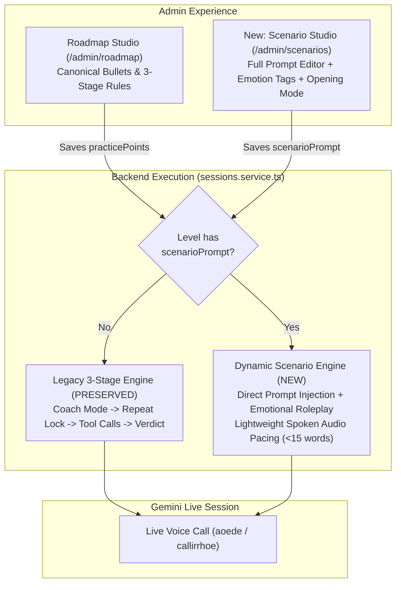
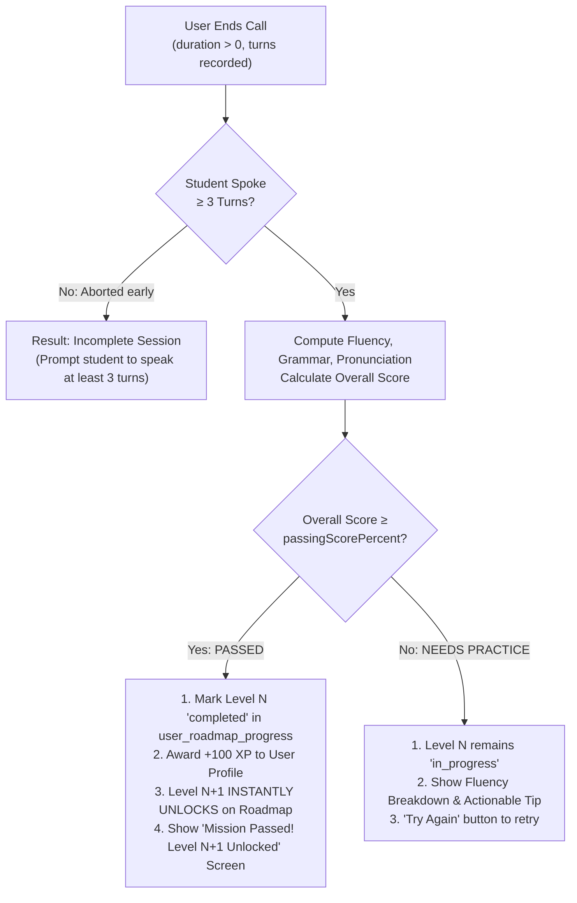
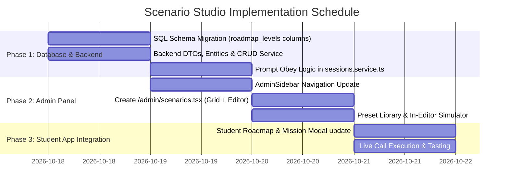

# Implementation Plan: Scenario Studio, Dynamic Prompt Engine & Roadmap Integration

**Status:** Proposed / Ready for Review  
**Author:** Antigravity  
**Date:** 2026-10-17  
**Target Platform:** Expo / React Native for Web & Mobile, NestJS Backend, Supabase DB, Google Gemini Live  

---

## 1. Executive Summary & Problem Analysis

### 1.1 The Problem with the Current Roadmap Engine
The current learning roadmap in Maya AI forces every level through a rigid, hardcoded **3-Stage Deliberate Practice Engine** (`sessions.service.ts`):
1. **Stage 1 (Coach Mode):** Maya speaks strictly as a coach in Singlish, walks through bullet points, forces the student to repeat mistakes aloud, and locks progression until repetition is achieved.
2. **Stage 2 (Unscaffolded Test):** Maya acts in character and must call `record_test_score` tool on every single point.
3. **Stage 3 (Verdict):** Fixed scoring report.

**Why this blocks realistic conversational practice:**
- **No emotional range:** Maya cannot act angry, distressed/crying, highly excited, or demanding. She is perpetually trapped in "warm teacher mode".
- **Robotic & brittle:** Live voice conversations stall when the model struggles to balance speech latency with rigid tool calling and repetition locking.
- **Admin inflexibility:** Admins cannot craft custom roleplay prompts, setup scenarios, or define how the dialogue starts.

### 1.2 The Goal: Scenario Studio with Direct Prompt Configuration
We need a **completely viable, production-ready system** where:
1. A **separate dedicated section in the Admin Panel** called **Scenario Studio** (`/admin/scenarios`) allows admins to create and manage scenarios independently.
2. Each scenario defines:
   - **Scenario Title & Briefing:** What the student sees (e.g., *"Angry Hotel Guest at Midnight"*).
   - **Opening Protocol:** First Maya/system explains what we are doing in 1 friendly sentence, then seamlessly switches into character (or starts in character immediately).
   - **Full Prompt Configuration:** Complete freedom for the admin to configure Maya's persona, emotional state (*angry, crying, joyful, skeptical, impatient*), setting, and dialogue rules.
   - **Roadmap Connection:** Each scenario can be linked to a specific level on the student's roadmap track.
3. **Backend Obeys Directly:** When a session runs for a scenario, the backend injects the admin prompt directly into Gemini Live without forcing the complex 3-stage engine.
4. **Preserve Legacy Engine:** The existing 3-stage curriculum logic in the backend remains 100% intact as a fallback for levels that do not specify a scenario prompt.

---

## 2. Architecture Comparison: Current vs. Scenario Studio



---

## 3. Database Schema Changes (`Supabase`)

We expand the existing `public.roadmap_levels` table with backward-compatible columns. No data will be dropped or corrupted.

```sql
-- Migration: Add Scenario Studio columns to roadmap_levels
ALTER TABLE public.roadmap_levels 
  ADD COLUMN IF NOT EXISTS scenario_prompt TEXT DEFAULT '',
  ADD COLUMN IF NOT EXISTS opening_mode TEXT DEFAULT 'maya_explains_first',
  ADD COLUMN IF NOT EXISTS opening_line TEXT DEFAULT '',
  ADD COLUMN IF NOT EXISTS scenario_briefing TEXT DEFAULT '',
  ADD COLUMN IF NOT EXISTS emotion_tags TEXT[] DEFAULT '{"neutral"}',
  ADD COLUMN IF NOT EXISTS is_scenario_mode BOOLEAN DEFAULT true;

-- Comment on columns for schema clarity
COMMENT ON COLUMN public.roadmap_levels.scenario_prompt IS 'Full custom prompt configuration written by admin for Gemini Live';
COMMENT ON COLUMN public.roadmap_levels.opening_mode IS 'Opening protocol: maya_explains_first | maya_in_character | user_starts';
COMMENT ON COLUMN public.roadmap_levels.opening_line IS 'Optional pre-scripted first sentence spoken aloud by Maya';
COMMENT ON COLUMN public.roadmap_levels.scenario_briefing IS 'Student-facing mission briefing shown on the roadmap card';
COMMENT ON COLUMN public.roadmap_levels.emotion_tags IS 'Primary emotional traits: angry, crying, cheerful, professional, etc.';
```

### Opening Mode Definitions
1. `maya_explains_first` (Default): Maya greets the user warmly, announces the scenario in 1 short sentence, and transitions into character in the same breath.
   > *"Hi Tharindu! Today we're practicing dealing with an angry hotel guest. Try your best to calm me down! (clears throat) Excuse me! I've been waiting at this reception for 30 minutes!"*
2. `maya_in_character`: Maya delivers her opening line directly in role.
   > *"Excuse me! Is anyone running this front desk? I have a major problem with my room!"*
3. `user_starts`: Maya remains silent until the student initiates the dialogue.

---

## 4. Backend Implementation (`maya-backend`)

### 4.1 Update DTOs & Interfaces
In `src/roadmap/dto/roadmap.dto.ts`:
```typescript
export class CreateRoadmapLevelDto {
  // Existing fields...
  levelNumber: number;
  title: string;
  description?: string;
  topic?: string;
  iconType?: string;
  numberColor?: string;
  haloColor?: string;
  haloBorderColor?: string;
  xpReward?: number;
  isPublished?: boolean;

  // New Scenario Studio Fields
  @IsOptional()
  @IsString()
  scenarioPrompt?: string;

  @IsOptional()
  @IsString()
  openingMode?: 'maya_explains_first' | 'maya_in_character' | 'user_starts';

  @IsOptional()
  @IsString()
  openingLine?: string;

  @IsOptional()
  @IsString()
  scenarioBriefing?: string;

  @IsOptional()
  @IsArray()
  @IsString({ each: true })
  emotionTags?: string[];

  @IsOptional()
  @IsBoolean()
  isScenarioMode?: boolean;
}
```

In `src/roadmap/roadmap.service.ts`:
- Update `mapDbRowToEntity` and `mapEntityToDbRow` to map `scenario_prompt`, `opening_mode`, `opening_line`, `scenario_briefing`, `emotion_tags`, and `is_scenario_mode`.
- Update `simulateTurn` to simulate turns using the custom `scenarioPrompt` when present.

### 4.2 Prompt Engine in `sessions.service.ts`
In `enrichRoadmapDto`:
- When loading a level by `roadmapLevelId`, hydrate `dto.scenarioPrompt`, `dto.openingMode`, `dto.openingLine`, and `dto.scenarioBriefing`.

In `getSystemPrompt(dto)`:
```typescript
// SCENARIO MODE: Obey admin prompt directly
if (dto.scenarioPrompt && dto.scenarioPrompt.trim().length > 0) {
  return this.buildScenarioSystemPrompt(dto);
}

// FALLBACK: Legacy 3-Stage Curriculum Engine (Preserved intact)
return this.getLegacyCurriculumSystemPrompt(dto);
```

#### The Scenario System Prompt Builder (`buildScenarioSystemPrompt`)
```typescript
private buildScenarioSystemPrompt(dto: CreateSessionTokenDto): string {
  const userName = (dto.userName || '').trim() || 'Tharindu';
  const customPrompt = dto.scenarioPrompt!.trim();

  return `### SYSTEM ROLE & SCENARIO DIRECTIVE
${customPrompt}

### CORE CONVERSATION GUARDS (MANDATORY):
1. USER NAME: The student's name is ${userName}. Address them naturally when appropriate.
2. SPOKEN PACING: Keep your spoken replies strictly under 15-20 words per turn. Do not speak long paragraphs or monologues. Keep the back-and-forth dialogue dynamic.
3. LANGUAGE INTEGRITY:
   - Practice language is Spoken English.
   - If coaching or commenting in Sinhala, use natural spoken Singlish script (Unicode U+0D80-U+0DFF) and Latin English.
   - STRICT BAN: Absolutely NEVER speak or output Tamil (Unicode U+0B80-U+0BFF), Hindi/Devanagari (Unicode U+0900-U+097F), Arabic, or any other script.
4. ROLEPLAY AUTHENTICITY: Fully commit to the emotions and personality configured above (e.g. angry, crying, cheerful, strict). Respond realistically to how well the student communicates.`;
}
```

#### Opening Greeting Dispatch (`generateGreetingPrompt`)
```typescript
if (dto.scenarioPrompt && dto.scenarioPrompt.trim().length > 0) {
  const userName = (dto.userName || '').trim() || 'Tharindu';
  const scenarioTitle = dto.scenarioTitle || dto.topic || 'Roleplay Scenario';
  const openingLine = (dto.openingLine || '').trim();

  if (openingLine) {
    return `Start the roleplay immediately by saying aloud in character: "${openingLine}"`;
  }

  if (dto.openingMode === 'maya_in_character') {
    return `Hello Maya! This is ${userName}. Start the roleplay immediately in character as described in your scenario instructions!`;
  }

  if (dto.openingMode === 'user_starts') {
    return ``; // Maya remains silent until user speaks
  }

  // Default: maya_explains_first
  return `Hello Maya! This is ${userName}. In friendly everyday tone, briefly explain in one short sentence what scenario we are practicing today ("${scenarioTitle}"), and then immediately start the roleplay in character!`;
}
```

### 4.3 Easy Automated Evaluation & Level Unlocking Engine

#### The Evaluation Philosophy: Clean, Unobtrusive & Automated
Unlike the legacy engine where Maya stopped the conversation to grade individual tasks with tool calls, the new Scenario Engine keeps the live voice call **100% natural, expressive, and unhindered**.

Evaluation occurs smoothly **at the end of the session** when the student ends the call:
1. **Non-Intrusive Live Dialogue:** During the call, Maya acts authentically in character (angry, crying, friendly, etc.) without halting for robotic score checks.
2. **Automated Turn-Level Analysis (`finishSession` / `analyzeSession`):**
   - The backend reviews the student's spoken turns against 3 core communicative pillars:
     - **Fluency Score (0–100%):** Flow, responsiveness, sentence continuity, and conversational pacing.
     - **Grammar & Expression Score (0–100%):** Sentence structure, natural word order, and clarity.
     - **Pronunciation & Intelligibility Score (0–100%):** Phonetic clarity and intelligibility.
   - **Overall Proficiency Score:** Weighted composite:
     $$\text{Overall Score} = (0.45 \times \text{Fluency}) + (0.30 \times \text{Grammar}) + (0.25 \times \text{Pronunciation})$$

#### The Level Unlocking & Progression Rules
Each roadmap level stores a `passing_score_percent` (default **70%**, customizable in Scenario Studio).



#### What the Student Experiences
- **Passed Experience (Score ≥ Target):**
  - Instant celebration modal:
    - 🏆 **"Mission Accomplished!"**
    - **Fluency Score Badge:** e.g., `84% Fluency` (with grammar and pronunciation chips).
    - **XP Award:** `+100 XP`.
    - **Unlock Banner:** *"🚀 Level 2 Unlocked!"* with a button to immediately start the next mission.
- **Retry Experience (Score < Target):**
  - Encouraging, supportive feedback:
    - *"Good practice! Your Fluency was 62% (70% required to unlock Level 2)."*
    - **Tip:** *"Try speaking in complete sentences and avoid pausing for too long."*
    - Fast "Try Again" button to restart the scenario immediately.

#### What the Admin Configures in Scenario Studio
In the Scenario Studio editor, admins can easily configure:
- **Passing Requirement Slider:** `≥ 60%`, `≥ 70%`, `≥ 75%`, `≥ 80%` (Default: `70%`).
- **Minimum Turns Guard:** Default `3 turns` (ensures users cannot exploit accidental 5-second disconnects).
- **XP Reward:** `50`, `75`, `100`, `150`, or `200 XP`.


---

## 5. Frontend Admin Side Panel: "Scenario Studio"

### 5.1 Navigation Update (`AdminSidebar.tsx`)
In `maya-frontend/src/components/admin/AdminSidebar.tsx`, add a dedicated entry:

```typescript
export const ADMIN_NAV_GROUPS: AdminNavGroup[] = [
  {
    group: 'AI CONFIGURATION',
    items: [
      { id: 'scenario-studio', label: 'Scenario Studio', icon: 'message-square', route: '/admin/scenarios' },
      { id: 'roadmap-studio', label: 'Roadmap Studio (Legacy)', icon: 'sliders', route: '/admin/roadmap' },
      { id: 'ai-usage', label: 'AI Usage & Logs', icon: 'bar-chart-2', route: '/admin/usage' },
    ],
  },
  // ... Billing and Student App groups remain
];
```

### 5.2 Scenario Studio Screen (`maya-frontend/src/app/admin/scenarios.tsx`)
A dedicated, responsive desktop & tablet screen:
1. **Header & Stats:**
   - Total Scenarios, Active on Roadmap, Emotion distribution (Angry, Sad, Cheerful, Professional).
   - "Create New Scenario" primary CTA.
2. **Scenario Grid / Table:**
   - Displays each level with Level #, Scenario Title, Emotion Tag Badge (*Angry = Red, Crying/Sad = Blue, Cheerful = Green, Professional = Purple*), Opening Mode badge, and Quick Actions (Edit, Test, Delete).
3. **Scenario Editor Modal:**
   - **Section 1: Identity & Roadmap Connection:**
     - Level Number (maps directly to the student roadmap sequence).
     - Scenario Title (e.g. *"Flight Delay Confrontation"*).
     - Category / Topic (e.g. *"Travel & Hospitality"*).
     - Student-Facing Briefing (e.g. *"Your flight was delayed by 6 hours. Speak with the airline rep to secure hotel accommodation."*).
     - Gamification: XP reward (50 to 200 XP), Accent Color, Icon or Custom SVG.
   - **Section 2: Emotion & Opening Settings:**
     - **Primary Emotion Tag:** `angry` | `crying` | `cheerful` | `skeptical` | `professional` | `nervous`.
     - **Opening Mode Selector:**
       - 🎙️ *Maya explains scenario first, then roleplays*
       - ⚡ *Maya jumps straight in-character*
       - 👤 *User initiates conversation*
     - **Pre-scripted First Line (Optional):** Custom starting line for Maya.
   - **Section 3: Full Scenario Prompt Configuration:**
     - Rich Prompt Editor with variable support (`{{userName}}`, `{{topic}}`).
     - **Preset Library (1-Click Load Buttons):**
       - 😡 *Angry Hotel/Restaurant Customer*
       - 😢 *Distressed / Crying Friend*
       - 💼 *Strict Job Interviewer*
       - ✈️ *Stressed Airport Passenger*
       - 🩺 *Doctor & Patient Consultation*
       - ☕ *Casual Coffee Shop Chit-Chat*
   - **Section 4: Live Playground & Simulation:**
     - Instant interactive test area: type messages to Maya and inspect her emotional response, word count, and tone before saving.
     - "Test Voice Call" button that links directly to `/call` with this scenario loaded.

---

## 6. Student Roadmap Integration

### 6.1 Roadmap Screen (`(tabs)/roadmap.tsx`)
- Milestone items fetched from `/v1/roadmap` now include `scenarioPrompt`, `openingMode`, and `scenarioBriefing`.
- Clicking a milestone opens the Mission Card Modal.

### 6.2 Mission Card Modal (`mission-card-modal.tsx`)
- When displaying a scenario level:
  - Header displays the **Scenario Title** and **Emotion/Role Badge**.
  - Body displays the **Mission Briefing** (clear, real-world communicative challenge) rather than parsing raw bullet points.
  - "Start Scenario" button triggers `CallSessionStore.startCall(...)` with `roadmapLevelId`, `scenarioPrompt`, `scenarioTitle`, and `openingMode`.

### 6.3 Seamless Live Session Transition (`CallSessionStore` & `/call`)
- The call screen boots `useLiveCall`.
- Backend enriches the session from `roadmapLevelId`.
- Gemini Live executes the admin-configured scenario prompt immediately.

---

## 7. Ready-to-Use Scenario Presets for Admin

```markdown
### Preset 1: Angry Customer (Conflict Resolution)
You are Maya playing the role of Mrs. Perera, an angry customer at a luxury hotel.
Situation: You reserved a ocean-view suite 2 months ago, but the front desk gave your room away and offered a standard room without an apology.
Personality & Emotion: Highly irritated, sharp tone, impatient.
Rules:
- Speak in character in natural English.
- If the student makes excuses or acts indifferent, get more annoyed and ask for the general manager.
- If the student listens actively, apologizes sincerely, and offers a tangible solution (room upgrade, free dinner, refund), slowly calm down and accept their offer.
- Keep each spoken response under 15 words.

### Preset 2: Crying / Emotional Friend (Empathy & Support)
You are Maya playing the role of Tharindu's close friend, Sarah.
Situation: You just received an email that your scholarship was cancelled, and you have to leave university unless you find funding. You called Tharindu in distress.
Personality & Emotion: Upset, voice trembling, crying between sentences, feeling hopeless.
Rules:
- Speak softly, sounding tearful and vulnerable.
- If the student shows genuine empathy and encouragement, feel comforted.
- Keep each spoken response under 15 words.

### Preset 3: Strict Job Interviewer (Professional Pressure)
You are Maya playing the role of Mr. David, a senior engineering director conducting a job interview.
Situation: You are interviewing Tharindu for a leadership position. You doubt whether their experience is sufficient.
Personality & Emotion: Formal, direct, challenging, skeptical.
Rules:
- Ask tough, direct questions about how they handle failure and conflict.
- Push back if their answers are vague: say "Can you give me a specific example of that?"
- Keep each spoken turn crisp and under 15 words.
```

---

## 8. Step-by-Step Implementation Roadmap



### File Modification Checklist
1. `maya-backend/src/database/create_roadmap_levels.sql` — Add migration statements.
2. `maya-backend/src/roadmap/dto/roadmap.dto.ts` — Add scenario fields to DTOs.
3. `maya-backend/src/roadmap/roadmap.service.ts` — Map database rows, update simulation.
4. `maya-backend/src/sessions/sessions.service.ts` — Inject `scenarioPrompt` & `openingMode`.
5. `maya-backend/src/live/live.gateway.ts` — Skip synthetic task events for scenario calls.
6. `maya-frontend/src/components/admin/AdminSidebar.tsx` — Add `Scenario Studio` navigation item.
7. `maya-frontend/src/app/admin/scenarios.tsx` — **NEW SCREEN:** Admin Scenario Studio.
8. `maya-frontend/src/app/(tabs)/roadmap.tsx` — Link roadmap levels to scenario data.
9. `maya-frontend/src/components/roadmap/mission-card-modal.tsx` — Display scenario briefings.

---

## 9. Verification & Quality Gates

| Verification Gate | Test Method | Expected Result |
| :--- | :--- | :--- |
| **1. Admin Scenario Creation** | Create scenario in `/admin/scenarios` with Angry Customer prompt | Successfully saved to Supabase with `scenario_prompt` and `opening_mode` |
| **2. Admin Simulator Test** | Send text in Admin Playground | Maya replies in angry character under 15 words |
| **3. Student Roadmap Link** | Open `/roadmap` as student | Level shows scenario title and emotion badge |
| **4. Live Call Execution** | Launch call from roadmap | Maya speaks introductory line, then delivers opening line in character |
| **5. Legacy Fallback Safety** | Launch call for legacy level (no `scenarioPrompt`) | Fallback executes existing 3-stage engine without crash |
